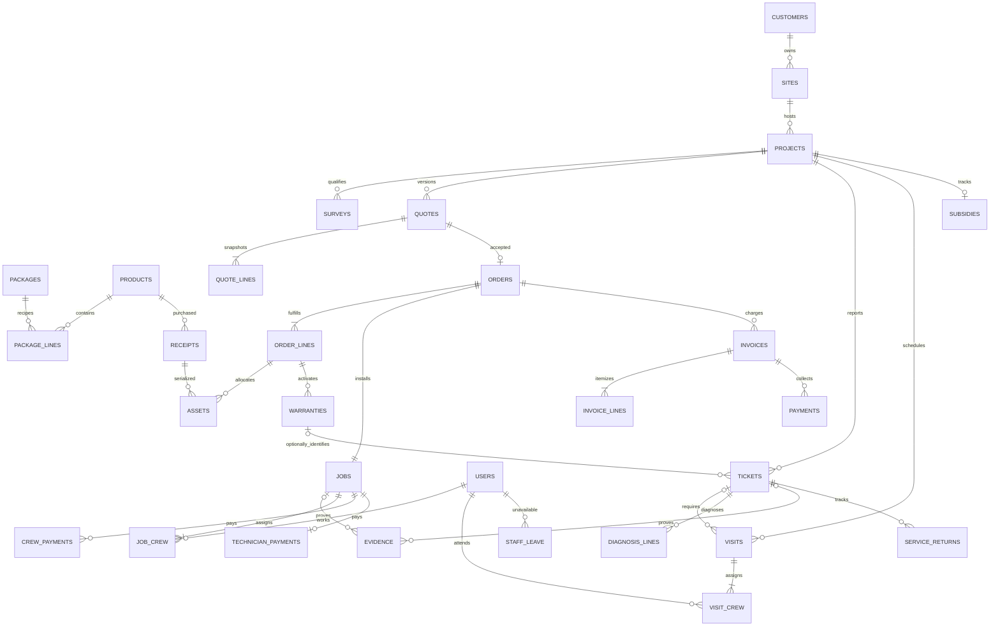

# Architecture and database walkthrough

The browser talks to a same-origin Fastify API. PostgreSQL owns persisted business state; private image files live in a separate volume. No Firebase, hosted database, external AI API, payment gateway or messaging service is required.

## Module map

- `packages/contracts`: TypeBox JSON schemas shared with TypeScript. Fastify rejects invalid API requests independently of the UI.
- `apps/api/src/modules/sales.ts`: enquiry, survey, quotation snapshots, acceptance and payments.
- `inventory.ts`: receipts, reservation, serialized allocation, dispatch and delivery.
- `field.ts`: installation crews, evidence-based completion, per-worker time and payouts, and subsidy tracking.
- `scheduling.ts`: shared skills/leave/buffer checks, atomic crew booking, rescheduling and visit outcomes.
- `service-operations.ts` (exported through `service.ts`): assigned repair access, diagnosis revisions, approved per-component coverage, labour/callout billing, replacement lineage and confirmation.
- `staff.ts`: audited role, qualification and working-day changes with session revocation.
- `queries.ts`: read models and SQL-derived financial reports.
- `plugins/auth.ts`: Argon2id, opaque hashed sessions, CSRF and role authorization.
- `plugins/files.ts`: image decoding, size/pixel limits, metadata removal, private storage and authorized reads.

Routes authorize the caller and open a transaction; domain modules own business operations and parameterized SQL. This first release keeps each domain’s writes together instead of adding a repository wrapper around every individual SQL statement. Read queries are separated. All statements in one mutation use the same acquired PostgreSQL client.

## Integrity choices worth demonstrating

1. **Survey gate:** issue/accept locks the project, checks the latest survey and binds the quotation to that approved version.
2. **Immutable commercial snapshots:** quote/order lines copy descriptions, prices, quantities and warranty months. Database triggers protect accepted quote and order terms. Updating the catalogue cannot change historic accepted amounts.
3. **Concurrency:** reservation locks products in a stable order. A scan locks the order and asset. A globally unique serial and exclusive row lock prevent double allocation. Dispatch requires every serialized line to be complete.
4. **Delivery warranty:** dispatch consumes stock but creates no warranties. Delivery locks the order and stamps the dates once. Repeated delivery returns the original result.
5. **Idempotency:** browser mutations carry a stable key for an unchanged retry. An advisory transaction lock serializes matching keys. The key, route, body hash and response are persisted atomically with the business operation. Reusing a key with a changed payload fails. Payment references are additionally unique per invoice.
6. **Cost basis:** serialized devices use their actual receipt cost. Quantity-tracked material uses moving weighted-average stock value, rounded to the nearest paise at dispatch. The consumed amount is saved on the order line. Acquisition purchases remain warehouse value until consumed.
7. **Money:** integer paise stored as BIGINT; arithmetic is exact for the bounded supported domain. Proportional quantity costs use BigInt intermediate arithmetic. PostgreSQL aggregates are converted only within JavaScript’s safe integer range.
8. **Service:** coverage uses `starts_at <= opened_at < expires_at`; the decision is saved. Covered work bills zero while retaining internal cost. Expired work creates parts/labour invoice lines. Replacements use available stock, link old to new, and inherit original warranty dates under an explicit demo policy.
9. **Finance:** completed contribution is invoice value minus dispatched material, installation labour and repair cost. Incomplete jobs display “work in progress”. Cash is payments by actual payment date. The project report is a cohort of orders confirmed in the selected period; it is not statutory accrual accounting.

## Policies and first-release boundaries

Demo policy is deliberately explicit: 30% minimum advance, 8 m² usable roof per kW, no unconfigured tax, 24-month inverter/battery/controller coverage, 240-month panel coverage, replacement coverage inherits the original end date. Panel coverage is quantity-tracked per order line; inverter/battery/controller coverage is serial-specific. Prices and warranty duration live in products, recipes in versioned package tables, advance policy in settings. These are business configuration data, not claims about government eligibility or electrical engineering design.

Each installation and service visit has one qualified lead and may include additional named workers. Shared availability checks lock workers before confirmation. Installation time, saved rates, cost and payouts are tracked per worker. Repair diagnosis revisions bind approval and current-visit evidence; issued service documents retain gross prices, warranty credits and separate callout lines. Statutory payroll, external accounting integrations and automatic offline mutation synchronization remain outside this build. Reviewed credits/refunds, pre-dispatch cancellation and supplier claims are now implemented. Historical seed installations are explicitly synthetic imports; they do not pretend to include real photos or signatures. New live completions require saved evidence.

The PWA precaches the public static shell only. API responses and evidence are never added to runtime caches. Read-query data stays in memory; unsent enquiry and diagnosis drafts and retry keys use user-scoped session storage for up to 24 hours. Signing out clears the query cache and saved drafts. Uploads are decoded before persistence and are not publicly served from the static directory.

## Service operations additions

Migrations 003–009 add visits, visit crews, staff leave, installation crews and individual payouts, diagnosis lines, repair evidence revisions, returns quarantine and linked follow-up tickets. User capabilities remain one role per named account. The coordinator role explicitly combines phone intake with dispatch and review; it does not inherit finance or staff administration. Backend transactions and record-level access remain authoritative.

## Review completion additions

Migrations 010–023 add operational tasks and holidays, financial corrections and refunds, shared customer/site records and history, component evidence, reviewed service outcomes, external equipment, supplier claims and recoveries, parts readiness, line delivery receipts and custody incidents, stock count review and quarantine, paid-order cancellation, quote discounts, engineering substitutions, linked change orders and transit replacement records. The database now has 58 public tables including migration tracking.

Discounts are limited to 1–20% under the demo policy and require another administrator; the result is a new quote version. Extra work is a linked project with its own survey approval, quote, customer acceptance and invoice. Pre-dispatch cancellation requires separate finance review and releases reservations; actual money returned is recorded separately as a bounded refund.

Availability ranks qualified free workers by booked hours, then name and staff ID. Travel uses the stated fixed 30-minute buffer rather than a live routing provider. Requests waiting over seven days are promoted for human review to avoid starvation; urgent hazards remain explicit coordinator tasks. No appointment is silently displaced.

Repair drafts require manual resubmission after reconnecting. Parts readiness is checked against current unreserved stock at booking and final consumption, not a guaranteed supplier delivery date. Different replacement models require explicit engineering notes, customer agreement and price approval; the software does not certify electrical compatibility.

The named training-workspace command creates or resets only a marked solar_training_ namespace. It uses a separate configuration and upload path, leaving operational records outside that namespace unchanged.

## Customer accounts and notifications

Migration 024 links the customer role to exactly one customer identity and records recipient-owned inbox events. Authentication denies all staff routes for customer sessions before their handlers run. Portal queries select only the linked customer and its projects; private staff files and internal acquisition/labour costs are not exposed. Database triggers record repair, appointment, installation, order-status and invoice updates in the same transaction as the business change. The visible page polls every 15 seconds and can refresh immediately. No external messaging provider or background push delivery is configured.
