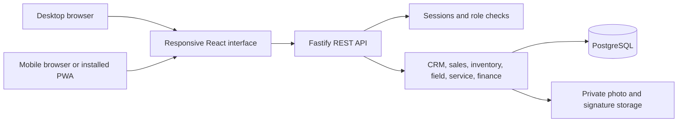

# Technology decisions

Status: implemented on 31 October 2026. Exact direct versions and the dependency lockfile are committed. This supersedes the provisional NestJS proposal from the initial investigation. Actual runtime checks and packaging limitations are recorded in VERIFICATION.md.

## Architecture

Use a TypeScript workspace with a responsive React client, a modular Fastify server and one local PostgreSQL database. Build and serve the frontend and API from the same origin for the packaged demo. Keep the Vite development server behind its API proxy during development.

## Final stack

| Concern | Selection | Why |
| --- | --- | --- |
| Runtime | Node.js 24 + npm workspaces | The local runtime is 24.15.0. One language and a simple workspace reduce solo setup overhead. |
| UI framework | React 19 + TypeScript + Vite 8 | Component reuse across desktop and phone layouts, straightforward local development. |
| Navigation | React Router | Nested role-aware application routes and mobile detail/back navigation. |
| Styling | Tailwind CSS 4 | Responsive layouts and shared semantic design tokens. |
| Components | shadcn/ui, official `@shadcn` registry, Base UI primitives, Lucide | Editable local components with consistent keyboard and form behavior. Review generated source; do not mix Base UI and Radix component APIs. |
| Server data | TanStack Query 5 | Pending/error/refetch states and invalidation after mutations; PostgreSQL remains the source of truth. |
| Forms | React Hook Form 7 | Accessible field feedback and preserved inputs after server errors. |
| Contracts | TypeBox with Fastify's compatible type provider | Shared TypeScript types and JSON Schemas. Fastify validates every API request; add business-rule checks separately. |
| Backend | Fastify 5 | Explicit route/service/repository modules, schema validation, structured errors and API injection for tests. |
| API documentation | OpenAPI via Fastify Swagger plugins | Describe real request/response contracts, roles and failure cases. |
| Database | PostgreSQL 18 | Relational constraints, joins, transactions and concurrency control match the brief and organizer guidance. Local CLI reports 18.6; service readiness must still be verified. |
| Database access | `pg` / node-postgres 8 | Parameterized SQL and visible transactions. Repositories isolate row mapping. No hosted backend or ORM required. |
| Migrations | Ordered SQL files and a migration ledger | Reproducible setup, explicit FK/index definitions, migration execution within supported transactional boundaries. |
| Authentication | Local accounts, Argon2id password hashes, opaque sessions persisted in PostgreSQL | Revocable sessions, role checks and resource access control. Use maintained crypto/cookie libraries; do not implement hashing algorithms. |
| Session protection | HttpOnly cookies, Secure over HTTPS, SameSite policy, CSRF protection, login throttling | Protect browser-authenticated mutations; never store session credentials in localStorage. |
| File evidence | Multipart uploads to a private volume, metadata in PostgreSQL | Photos and signatures stay associated with a job and require authorization to retrieve. Validate size/type and generate server-side names. |
| Barcode capture | `@zxing/browser` + compatible `@zxing/library`; keyboard-wedge scanner support | Decode on-device without calling an external service. Manual entry is an explicit fallback. |
| Signature capture | `signature_pad` | Touch/mouse signature input, linked to a saved completion record. This is evidence capture, not identity certification. |
| Reports | SQL-backed summaries, responsive charts/tables, print styles and CSV export | Trace totals to records; prevent CSV formula injection. Print-to-PDF provides shareable reports without a remote PDF API. |
| PWA shell | Manifest and a small service worker using `vite-plugin-pwa` | Home-screen/app-like access where supported. Cache only the public static shell, not authenticated APIs or private evidence. |
| Tests | Vitest, Fastify `inject`, PostgreSQL integration tests, Playwright | Test business invariants and real database behavior, then complete browser journeys across desktop/mobile viewports. |
| Packaging | Docker Compose with PostgreSQL/data/upload volumes | Repeatable startup on a judge's machine. Also document local PostgreSQL setup as a development fallback. |

## Dependency compatibility policy

The npm registry was checked on 31 October 2026. Relevant observed versions were React 19.3.1, Vite 8.3.5, Fastify 5.12.7, Tailwind 4.3.3, TanStack Query 5.105.0, React Hook Form 7.91.0, pg 8.23.1 and vite-plugin-pwa 2.0.0. These are a discovery snapshot, not an executed compatibility test.

The inspected Fastify TypeBox provider 6.3.0 declares `typebox ^1.1.14` and `ajv-formats ^3.0.1` peers. Use its actual current package family rather than mixing it with old `@sinclair/typebox` examples. Select compatible Fastify plugins and form resolvers, then pin resolved versions in `package-lock.json`. Build, typecheck and run a request/form round-trip before accepting the dependency set. Do not upgrade during the final freeze.

## Desktop and mobile contract

| Area | Desktop | Mobile/tablet |
| --- | --- | --- |
| Navigation | Sidebar, breadcrumbs and keyboard access | Compact header/drawer; technician view gets a short bottom navigation |
| Lists | Searchable/filterable tables with pagination | Cards or essential columns with a detail route; no whole-page horizontal scrolling |
| Forms | Group related fields where space permits | One column, visible labels, suitable input keyboards and approximately 48px primary targets |
| Detail screens | Master/detail or tabbed content | Stacked sections and persistent, unobscured primary action |
| Evidence | File picker, drag/drop optional, mouse signature | Camera/file picker, touch signature, upload progress and retry |
| Reports | Full detail tables and readable charts | Essential totals, expandable breakdowns and table alternatives |
| Interruptions | Preserve form state and show server validation | Preserve draft until saved; clear pending/error state; never imply an offline mutation committed |

Acceptance viewport targets: 360, 390 and 430 CSS px phone widths; 768px tablet; 1280 and 1440px desktop. Check 200% zoom, focus order, contrast, non-color status cues and reduced motion. The target browsers are current Chrome/Edge/Firefox desktop, Safari desktop, Chrome Android and Safari iOS.

Automated coverage uses Chromium, Firefox and WebKit, plus mobile emulation. WebKit and viewport emulation are not proof of physical iOS/Android compatibility: perform an actual-phone check for camera permissions, file picking, signature gestures and keyboard interaction when a device is available. Record any unavailable device coverage.

## HTTPS, installation and offline scope

Camera streaming requires a secure context. `localhost` on a laptop does not make a phone's plain HTTP LAN connection secure. Establish trusted HTTPS for the chosen phone demo route early; do not postpone this to presentation time. Keep the database and credentials private. A tunnel/cloud demo is optional only if event rules and access permit it.

PWA installation differs by browser and platform. The core acceptance criterion is that the website works in the browser. The lightweight installable shell is a convenience target; it does not replace responsive testing. Do not promise push notifications, background sync or identical installation prompts on every platform.

No automatic offline payment, dispatch or warranty mutations in the first release. Show offline status and retain recoverable local form state where appropriate. Clear sensitive drafts on logout/account change. Never cache private photos, financial data or authenticated API responses in the service worker.

## Tradeoffs

- Fastify is selected over NestJS to reduce framework ceremony for one developer. Keep explicit modules so simplicity does not turn into one giant route file.
- PostgreSQL is selected over Firebase/Supabase-hosted backends to align with the supplied transcript. The Supabase-authored skill is database guidance, not a dependency on its service.
- A responsive PWA is selected over React Native/Flutter/Electron to share UI and avoid native packaging within the deadline.
- Explicit SQL is selected over an ORM to make data integrity and transactions easy to review. Parameterization, mapping and transaction-client discipline are mandatory.
- No Redis, message broker, microservices or WebSocket infrastructure by default. Persisted dynamic records and refetches meet the brief; add infrastructure only for an actual unresolved need.

## Primary references

- [Vite documentation](https://vite.dev/guide/)
- [shadcn/ui on Vite](https://ui.shadcn.com/docs/installation/vite)
- [Fastify validation](https://fastify.dev/docs/latest/Reference/Validation-and-Serialization/)
- [Fastify TypeBox provider](https://github.com/fastify/fastify-type-provider-typebox)
- [PostgreSQL constraints](https://www.postgresql.org/docs/current/ddl-constraints.html)
- [PostgreSQL locks](https://www.postgresql.org/docs/current/explicit-locking.html)
- [node-postgres transaction contract](https://node-postgres.com/features/transactions)
- [Browser camera requirements](https://developer.mozilla.org/en-US/docs/Web/API/MediaDevices/getUserMedia)
- [PWA installation requirements](https://developer.mozilla.org/en-US/docs/Web/Progressive_web_apps/Guides/Making_PWAs_installable)
- [Playwright device emulation](https://playwright.dev/docs/emulation)

The library choices and delivery scope are engineering decisions. Neither supplied document mandates a particular language or framework.
